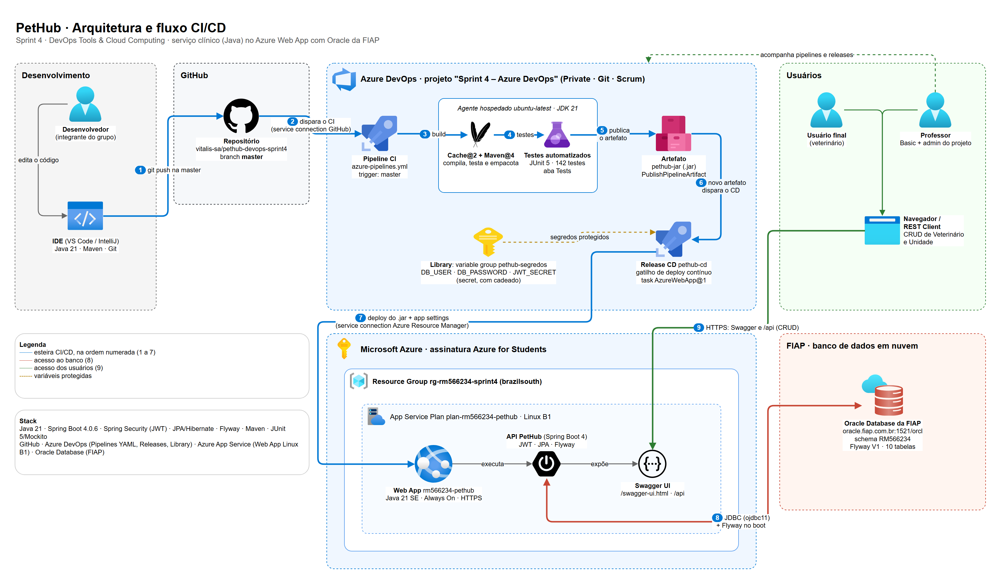

# PetHub · CI/CD no Azure DevOps (Sprint 4)

Entrega da disciplina **DevOps Tools & Cloud Computing** (FIAP, Challenge 2026, 2º semestre, **Sprint 4**).
Este repositório leva o **serviço clínico do PetHub** (backend Java da disciplina Java Advanced) para uma esteira de
**CI/CD no Azure DevOps**: cada push na `master` compila, roda os testes automatizados e publica o artefato; o novo
artefato dispara o deploy automático no **Azure Web App**, que usa o **Oracle da FIAP** como banco em nuvem.

> O código da aplicação veio do repositório [`vitalis-sa/pethub-java`](https://github.com/vitalis-sa/pethub-java),
> clonado **com o histórico de commits**. A documentação completa da API (endpoints, perfis, fluxos, IA) está em
> [`README-java.md`](README-java.md).

## Entrega

| Item | Link |
|---|---|
| Repositório GitHub | https://github.com/vitalis-sa/pethub-devops-sprint4 |
| Projeto no Azure DevOps | _(preencher: https://dev.azure.com/&lt;organização&gt;/Sprint%204%20%E2%80%93%20Azure%20DevOps)_ |
| Vídeo no YouTube | _(preencher)_ |
| Aplicação no Azure Web App | https://rm566234-pethub.azurewebsites.net/swagger-ui.html |

## Integrantes

| Nome | RM | Turma |
|---|---|---|
| Ana Flávia Camelo | RM561489 | 2TDSPV |
| Gustavo Kenji Terada | RM562745 | 2TDSPV |
| João Guilherme Carvalho Novaes | RM566234 | 2TDSPV |
| Pedro Chasci Puga | RM565154 | 2TDSPV |
| Lucas Figueiredo Vieira | RM561342 | 2TDSPV |

## 1. Descrição da solução

O **PetHub** é uma plataforma de cuidado veterinário contínuo que liga tutor (responsável), veterinário e clínica.
Este serviço é o **clínico**: cadastra veterinários e unidades veterinárias, pets, consultas com validação de
agenda, prontuário (diagnósticos, exames, pedidos médicos, vacinas e tratamentos) e o atendimento assistido por IA.
É uma **API REST** protegida por JWT e documentada com Swagger.

### Stack

| Camada | Tecnologia |
|---|---|
| Aplicação | Java 21, Spring Boot 4.0.6, Spring Web, Spring Security (JWT HS256, BCrypt), Bean Validation, MapStruct, Lombok, springdoc-openapi (Swagger) |
| Persistência | Spring Data JPA (Hibernate), **Flyway** (versionamento do schema), driver `ojdbc11` |
| Banco de dados em nuvem | **Oracle Database da FIAP** (`oracle.fiap.com.br:1521/orcl`), schema `RM566234` |
| Build e testes | Maven, JUnit 5, Mockito, AssertJ (142 testes automatizados em 29 classes) |
| Versionamento | Git + **GitHub** (`master`) |
| CI/CD | **Azure DevOps**: Pipelines (CI em YAML), Releases (CD clássico), Library (variáveis protegidas) |
| Nuvem | **Azure App Service**: Web App Linux, Java 21 SE, plano B1 |

## 2. Arquitetura e fluxo CI/CD



Fluxo numerado (o mesmo do diagrama):

1. O **desenvolvedor** altera o código na IDE e faz `git push` para a branch `master` no **GitHub**.
2. O push dispara a pipeline de **CI** no **Azure DevOps** (gatilho `trigger: master` do `azure-pipelines.yml`).
3. Um agente hospedado (`ubuntu-latest`, JDK 21) restaura o cache do Maven, **compila e roda os testes automatizados**.
4. O resultado dos testes é publicado na aba **Tests** da execução.
5. O `.jar` executável é publicado como **artefato `pethub-jar`** no Azure DevOps.
6. O novo artefato aciona o **gatilho de implantação contínua** da Release **`pethub-cd`** (CD).
7. A Release lê as **variáveis protegidas** do variable group `pethub-segredos` e publica o `.jar` no **Azure Web App**
   (`rm566234-pethub`), gravando as configurações da aplicação.
8. No boot, a aplicação conecta ao **Oracle da FIAP** e o **Flyway** aplica as migrations pendentes.
9. O **usuário final** (veterinário, ou o professor pelo Swagger/REST Client) acessa a API publicada, e cada operação
   do CRUD é persistida no Oracle.

| Ferramenta | Onde atua |
|---|---|
| IDE (VS Code / IntelliJ) + Git | Desenvolvimento e `push` (passo 1) |
| GitHub | Repositório de código, origem do gatilho do CI (1–2) |
| Azure Pipelines | CI: build, testes e artefato (2–5) |
| Pipeline Artifacts (Azure DevOps) | Guarda o `.jar` de cada execução do CI (5) |
| Azure Releases | CD: deploy automático no Web App (6–7) |
| Azure DevOps Library | Variable group com usuário, senha e segredo protegidos (7) |
| Azure App Service (Web App) | Hospeda a API Java 21 (7–9) |
| Oracle da FIAP | Banco de dados em nuvem (8–9) |

## 3. Banco de dados em nuvem

**Oracle da FIAP** (aceito pelo enunciado), no schema `RM566234`, usado só por esta entrega. O schema é criado e
versionado pelo **Flyway** a partir de [`V1__schema_inicial.sql`](src/main/resources/db/migration/V1__schema_inicial.sql)
(10 tabelas, 10 sequences, 16 chaves estrangeiras); o Hibernate só valida (`ddl-auto=validate`).

Os SELECTs de evidência do CRUD estão em [`database/consultas-video.sql`](database/consultas-video.sql).

## 4. Projeto no Azure DevOps

| Campo | Valor |
|---|---|
| Project name | `Sprint 4 – Azure DevOps` |
| Description | Projeto para entrega da Sprint 4 do professor João Menk. Integrantes: RM561489 - Ana Flávia Camelo - 2TDSPV · RM562745 - Gustavo Kenji Terada - 2TDSPV · RM566234 - João Guilherme Carvalho Novaes - 2TDSPV · RM565154 - Pedro Chasci Puga - 2TDSPV · RM561342 - Lucas Figueiredo Vieira - 2TDSPV |
| Visibility | Private |
| Version control | Git |
| Work item process | Scrum |

**Acesso do professor:** convidado na organização com nível de acesso **Basic** (Organization Settings › Users) e
adicionado como **Project administrator** (Project Settings › Overview).

## 5. Pipelines

### CI: build + testes + artefato ([`azure-pipelines.yml`](azure-pipelines.yml))

Pipeline YAML conectada a este repositório do GitHub por uma *service connection*. Dispara a cada push na `master`.

| Task | O que faz |
|---|---|
| `Cache@2` | Restaura e salva o repositório local do Maven (`~/.m2`), deixando as execuções seguintes mais rápidas |
| `Maven@4` (`clean package`) | Compila com JDK 21, **roda os testes automatizados** e empacota o `.jar` (Spring Boot) |
| ↳ `publishJUnitResults` | Publica os relatórios JUnit (`surefire-reports`) na aba **Tests** |
| `CopyFiles@2` | Separa o `.jar` executável em `$(Build.ArtifactStagingDirectory)` |
| `PublishPipelineArtifact@1` | **Publica o artefato `pethub-jar`** no Azure DevOps |

Testes: os **142 testes** das 29 classes rodam no CI. O único teste que sobe o contexto inteiro e precisa do Oracle
(`PethubApplicationTests`) tem a tag JUnit `integracao` e fica de fora com `-DexcludedGroups=integracao`. Assim,
nenhuma credencial de banco chega ao agente de build.

### CD: deploy automático (Release clássica `pethub-cd`)

| Configuração | Valor |
|---|---|
| Artefato | Build da pipeline de CI, alias `_pethub-ci`, versão padrão *Latest* |
| Gatilho | **Continuous deployment trigger** ligado, filtro de branch `master`: cada artefato novo cria uma release |
| Stage | `Produção (Azure Web App)`, agente `ubuntu-latest` |
| Task | **Azure Web App** (`AzureWebApp@1`): assinatura pela *service connection* `azure-rm566234`, tipo *Web App on Linux*, app `rm566234-pethub`, pacote `$(System.DefaultWorkingDirectory)/_pethub-ci/pethub-jar/*.jar`, runtime `JAVA\|21-java21` |
| App settings | `-DB_USER $(DB_USER) -DB_PASSWORD $(DB_PASSWORD) -JWT_SECRET $(JWT_SECRET) -SERVER_PORT 80 -ARMAZENAMENTO_MODO local` |
| Variáveis | Variable group `pethub-segredos` vinculado à release |

### Regras da pipeline atendidas

| Regra do enunciado | Como foi atendida |
|---|---|
| I. Conectada ao repositório da aplicação | CI ligado a este repositório do GitHub por service connection |
| II. CI dispara a cada alteração na `master` | `trigger: branches: include: [master]` |
| III. CD dispara após novo artefato | Continuous deployment trigger da Release no artefato `pethub-jar` |
| IV. Variáveis sensíveis protegidas | Variable group `pethub-segredos` com `DB_USER`, `DB_PASSWORD` e `JWT_SECRET` como *secret* (cadeado); nada no código ou no YAML |
| V. Artefato gerado e publicado no Azure DevOps | `PublishPipelineArtifact@1` → `pethub-jar` |
| VI. Etapa de testes no CI | `Maven@4` roda os testes e publica os resultados |
| VII. Deploy em Azure Web App ou ACI | `AzureWebApp@1` → Web App `rm566234-pethub` |

## 6. Variáveis de ambiente

| Variável | Sensível | Onde fica |
|---|---|---|
| `DB_USER` | sim | Variable group `pethub-segredos` (secret) → app setting do Web App |
| `DB_PASSWORD` | sim | Variable group `pethub-segredos` (secret) → app setting do Web App |
| `JWT_SECRET` | sim | Variable group `pethub-segredos` (secret, ≥ 32 caracteres) → app setting do Web App |
| `SERVER_PORT` | não | `80`: porta que o App Service Linux encaminha para a aplicação |
| `ARMAZENAMENTO_MODO` | não | `local`: arquivos em disco, sem depender do Google Cloud Storage |

As integrações externas do serviço (Groq, RabbitMQ, Brevo, Google Cloud Storage e o serviço .NET) não são
configuradas nesta entrega: a API sobe e o CRUD funciona sem elas (a IA responde 503 e o e-mail fica pendente).

## 7. Como reproduzir

Requer Azure CLI com `az login` na assinatura. Os scripts de [`azure/`](azure/) criam e apagam recursos **pagos**.

```bash
bash azure/01-criar-webapp.sh   # Resource Group, App Service Plan B1 Linux e Web App Java 21
bash azure/02-status.sh         # estado, URL e teste do /api-docs
bash azure/99-cleanup.sh        # apaga tudo (só depois da correção)
```

No Azure DevOps: criar as service connections (GitHub e Azure Resource Manager), o variable group
`pethub-segredos`, a pipeline a partir de `azure-pipelines.yml` e a Release `pethub-cd` como na seção 5.

Para rodar localmente: `./mvnw spring-boot:run` com um `.env` (veja [`.env.example`](.env.example)); testes com
`./mvnw test` (ou `./mvnw test -DexcludedGroups=integracao` sem banco).

## 8. Demonstração do CRUD

Roteiro em [`docs/demo-crud.http`](docs/demo-crud.http) (VS Code + REST Client), contra a aplicação publicada:

1. Cadastrar o veterinário operador (`POST /api/auth/registrar/veterinario`) e usar o token devolvido.
2. **Unidade veterinária** (`/api/unidades`): inserir, consultar, atualizar e deletar.
3. **Veterinário** (`/api/veterinarios`): inserir, consultar, atualizar e deletar.

Depois de cada operação, o SELECT correspondente de [`database/consultas-video.sql`](database/consultas-video.sql)
mostra a persistência no Oracle.
